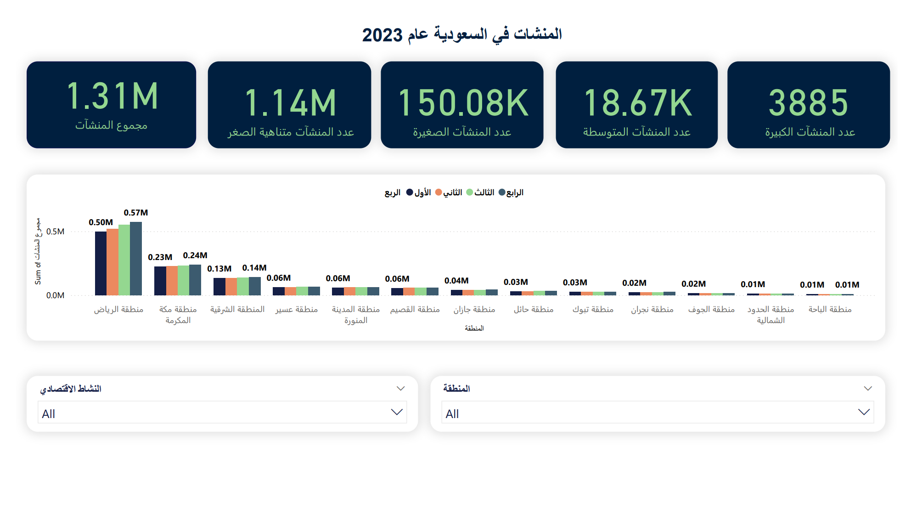

# Saudi Establishments in 2023 Dashboard

## Overview
Interactive dashboard analyzing 1.31M Saudi establishments by size (micro to large), 13 geographic regions, and quarterly performance.

## Tools
Power BI, Power Query

## Data Cleaning (Power Query)
- Cleaned the data and unpivoted quarterly columns
- Assigned correct data types

## Visuals
- KPI cards for key metrics
- Clustered column chart for regional and quarterly trends
- Slicers for Region and Economic Activity
  
## Key Insights
- **About 87% of Saudi establishments are micro-sized** (1.14M of 1.31M), followed by small (150K, about 11.5%). Medium and large establishments together are under 2% (18.67K and 3,885).
- **Riyadh dominates**, with roughly 0.57M establishments in Q4, about 43% of the total. Makkah (0.24M) and the Eastern Province (0.14M) follow.
- **The top three regions hold nearly three quarters of all establishments.** The remaining regions each have 0.06M or fewer.
- **Riyadh grew through the year**, from about 0.50M in Q1 to 0.57M in Q4, while most other regions stayed almost flat across quarters.
