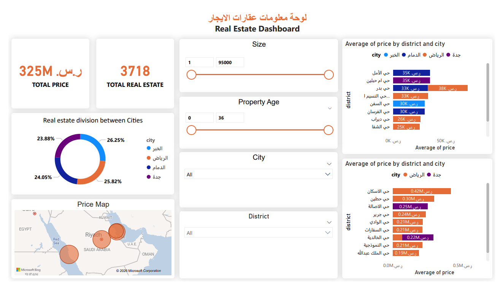

# Real Estate Rental Dashboard

## Overview
Interactive analysis of 3,718 rental properties (totaling SAR 325M) across key Saudi cities, evaluated by price, area size, property age, and district.

## Tools
Power BI, Power Query

## Data Cleaning (Power Query)
- Standardized city and district names
- Handled missing values
- Formatted numerical metrics

## Visuals
- KPI cards
- Donut chart for market share by city
- GIS map visual
- Bar charts for average district prices
- Dynamic range slicers
