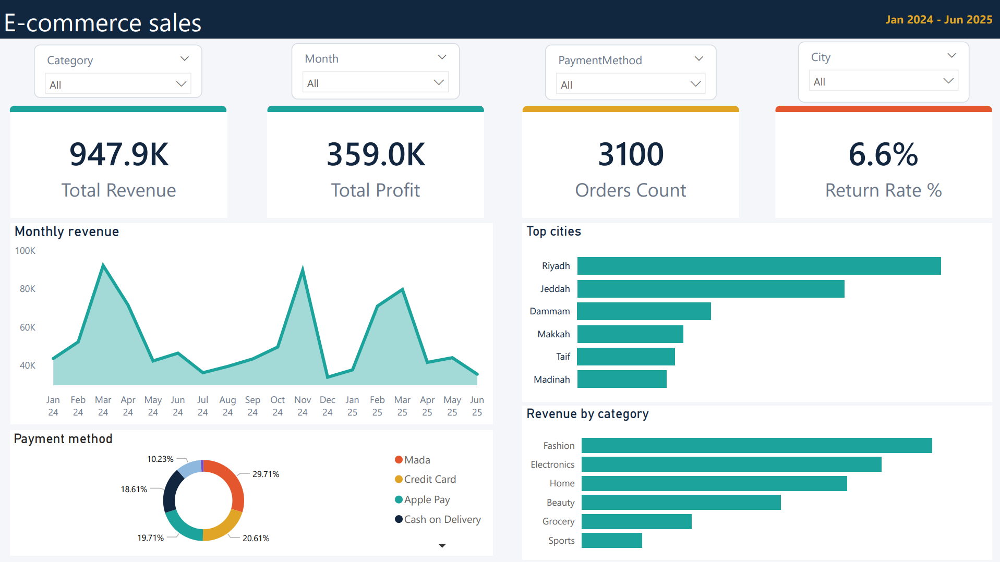

# E-commerce Sales Dashboard

## Overview
Interactive Power BI dashboard analyzing e-commerce sales across Saudi cities, categories, and payment methods (Jan 2024 - Jun 2025).

> Note: the dataset is synthetic, generated for practice.

## Tools
Power BI, Power Query, DAX, Excel

## Data Model
Star schema: Orders (fact), Customers, Products, and a Calendar table.

## Data Cleaning (Power Query)
- Standardized inconsistent city names
- Replaced missing payment methods with "Unknown"
- Removed 12 duplicate orders
- Set correct data types for all columns

## Key Measures (DAX)
Total Revenue, Total Profit, Orders Count, Return Rate %

## Key Insights
- Revenue peaks around Ramadan and White Friday
- Fashion and Electronics lead category sales
- Riyadh and Jeddah generate about half of total revenue
